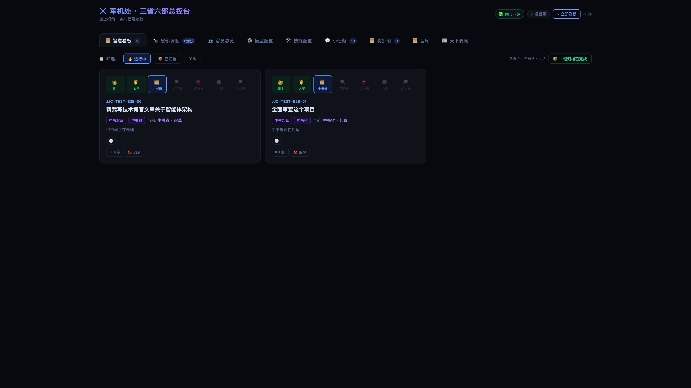
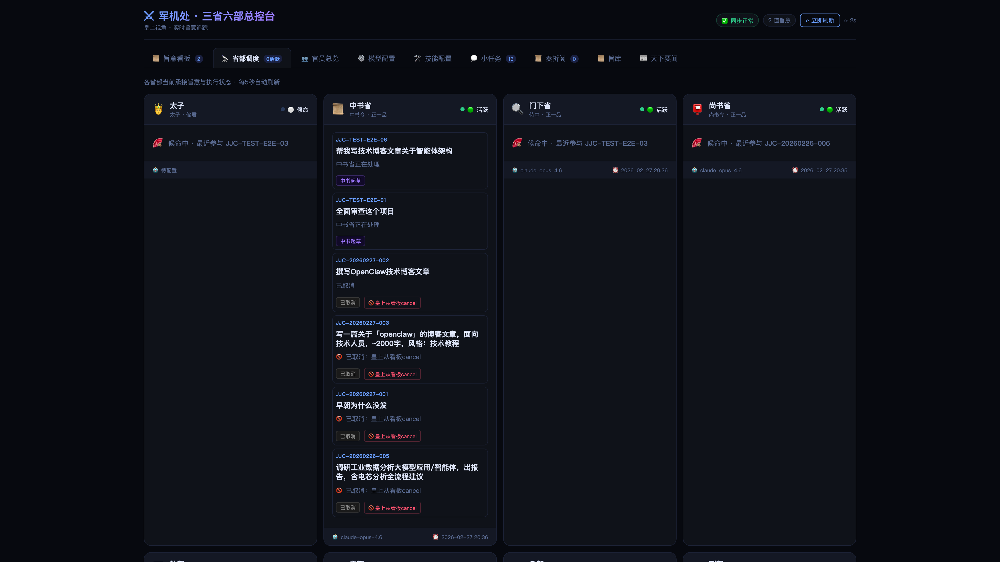
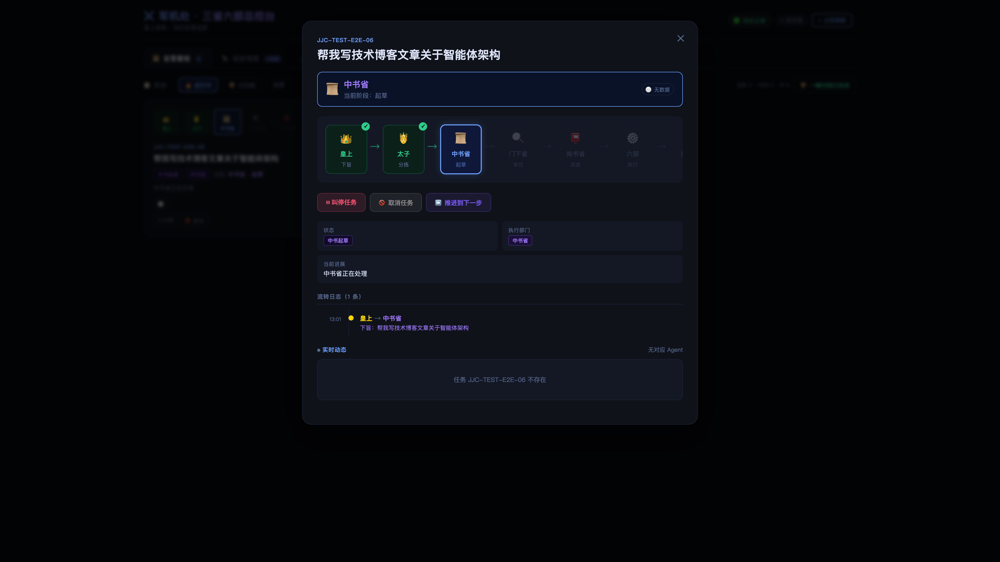

# 🏢 OCE 企业协作平台

<p align="center">
  <strong>基于现代企业治理架构的 AI 多 Agent 协作系统</strong>
</p>

<p align="center">
  <sub>20 个部门 + 143 名员工 + 10 个智能助理，构成分工明确、权责清晰的企业级 AI 协作网络。<br>比 CrewAI 多一层<b>制度性审核</b>，比 AutoGen 多一个<b>实时看板</b>。</sub>
</p>

<p align="center">
  <a href="#-demo">🎬 Demo</a> ·
  <a href="#-快速开始">🚀 快速开始</a> ·
  <a href="#-架构">🏗️ 架构</a> ·
  <a href="#-功能">📋 功能</a> ·
  <a href="docs/task-dispatch-architecture.md">📚 架构文档</a> ·
  <a href="README_EN.md">English</a> ·
  <a href="CONTRIBUTING.md">参与贡献</a>
</p>

<p align="center">
  
  
  
  
  
  
</p>

---

## 🎬 Demo

<p align="center">
  <video src="docs/Agent_video_Pippit_20260225121727.mp4" width="100%" autoplay muted loop playsinline controls>
    您的浏览器不支持视频播放，请查看下方 GIF。
  </video>
  <br>
  <sub>🎥 AI 多 Agent 协作全流程演示</sub>
</p>

> 🐳 **没有 OpenClaw？** 运行 `docker run -p 7891:7891 cft0808/oce` 即可体验完整看板 Demo。

---

## 💡 为什么是企业协作？

大多数 Multi-Agent 框架的套路是：

> *"来，你们几个 AI 自己聊，聊完把结果给我。"*

然后你拿到一坨不知道经过了什么处理的结果，无法复现，无法审计，无法干预。

**OCE 企业协作的思路完全不同** —— 采用现代企业治理架构：

```
领导 → 助理（分拣）→ 产品部（规划）→ 架构委员会（审核）→ 技术部（派发）→ 各部门（执行）→ 汇报
```

这是**真正的分权制衡**：

| | CrewAI | MetaGPT | AutoGen | **OCE** |
|---|:---:|:---:|:---:|:---:|
| **审核机制** | ❌ 无 | ⚠️ 可选 | ⚠️ Human-in-loop | **✅ 架构委员会专职审核** |
| **实时看板** | ❌ | ❌ | ❌ | **✅ 管理面板 + 时间线** |
| **任务干预** | ❌ | ❌ | ❌ | **✅ 暂停 / 取消 / 恢复** |
| **流转审计** | ⚠️ | ⚠️ | ❌ | **✅ 完整任务记录存档** |
| **Agent 健康监控** | ❌ | ❌ | ❌ | **✅ 心跳 + 活跃度检测** |
| **热切换模型** | ❌ | ❌ | ❌ | **✅ 看板内一键切换 LLM** |
| **技能管理** | ❌ | ❌ | ❌ | **✅ 查看 / 添加 Skills** |
| **新闻聚合推送** | ❌ | ❌ | ❌ | **✅ 每日资讯 + 飞书推送** |
| **部署难度** | 中 | 高 | 中 | **低 · 一键安装 / Docker** |

---

## ✨ 功能全景

### 🏢 多部门 Agent 架构

- **助理** 消息分拣 —— 闲聊自动回复，任务才建任务
- **产品部** 负责规划、方案设计
- **架构委员会** 负责审核、把关
- **技术部** 负责任务派发、协调
- **20个业务部门** 并行执行（开发、运维、安全、数据、运营、市场、采购、文档、咨询、项目管理、产品管理、经营管理、PMO等）
- 严格的权限矩阵
- 任务数据自动清洗

### 📋 管理面板（10+ 功能模块）

| 模块 | 功能 |
|------|------|
| **任务看板** | 状态列展示、筛选搜索、心跳徽章、详情查看、暂停/取消/恢复 |
| **部门调度** | 任务分布可视化、部门负载、健康状态 |
| **任务记录** | 已完成任务归档、五阶段时间线、Markdown 导出 |
| **任务模板** | 9 个预设模板、参数表单、预估时间/费用 |
| **成员总览** | Token 消耗排行、活跃度、完成数统计 |
| **每日资讯** | 自动采集科技/财经资讯、分类订阅 |
| **模型配置** | 每个 Agent 独立切换 LLM |
| **技能配置** | 各部门 Skills 一览、添加新技能 |
| **会话监控** | 实时监控 Agent 会话 |
| **欢迎仪式** | 首次打开播放开场动画 |
| **多方讨论** | 多 Agent 围绕议题展开讨论 |

---

## 🖼️ 截图





---

## 🚀 快速开始

### Docker 一键启动

```bash
docker run -p 7891:7891 cft0808/oce
```

打开 http://localhost:7891 即可体验。

### 完整安装

```bash
git clone https://github.com/cft0808/oce.git
cd oce
chmod +x install.sh && ./install.sh
```

### 启动服务

```bash
# 数据刷新循环
bash scripts/run_loop.sh

# 看板服务器
python3 dashboard/server.py

# 浏览器打开
open http://127.0.0.1:7891
```

---

## 🏗️ 架构

```
                    ┌─────────────────────┐
                    │      领导           │
                    │  Feishu · Telegram  │
                    └─────────┬───────────┘
                              │
                    ┌─────────▼───────────┐
                    │      助理           │
                    │   消息分拣/任务识别  │
                    └─────────┬───────────┘
                              │
                    ┌─────────▼───────────┐
                    │     产品部           │
                    │   规划/方案设计      │
                    └─────────┬───────────┘
                              │
                    ┌─────────▼───────────┐
                    │    架构委员会        │
                    │   审核/批准/驳回    │
                    └─────────┬───────────┘
                              │
                    ┌─────────▼───────────┐
                    │     技术部           │
                    │  派发/协调/汇总      │
                    └───┬─────┬─────┬─────┬───┐
                        │     │     │     │   │
                   ┌────▼┐ ┌───▼┐ ┌▼────┐ ┌▼────┐
                   │数据部│ │开发部│ │运维部│ │安全部│
                   └──────┘ └─────┘ └─────┘ └─────┘
```

---

## 📁 项目结构

```
oce/
├── agents/                 # Agent 人格配置
├── dashboard/             # 管理面板
│   ├── dashboard.html     # 前端页面
│   ├── server.py          # API 服务
│   └── court_discuss.py   # 讨论功能
├── scripts/               # 管理脚本
├── docs/                  # 文档
├── examples/              # 使用案例
└── install.sh             # 安装脚本
```

---

## 🔧 技术栈

| 组件 | 技术 |
|------|------|
| 前端 | React 18 + TypeScript + Vite + Zustand |
| 后端 | Python 标准库（零依赖） |
| 框架 | OpenClaw |
| 部署 | Docker / 一键脚本 |

---

## 📄 License

[MIT](LICENSE)

---

<p align="center">
  <strong>🤖 用现代企业治理，驾驭 AI 协作</strong>
</p>
